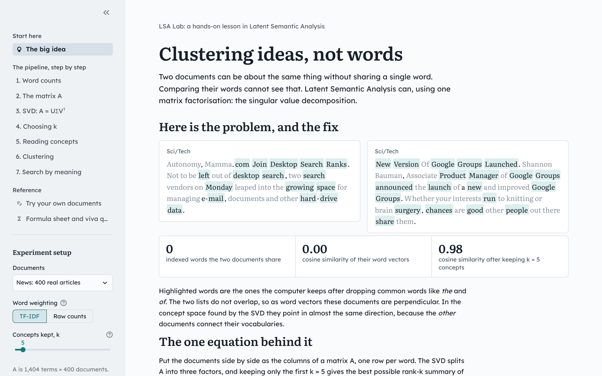
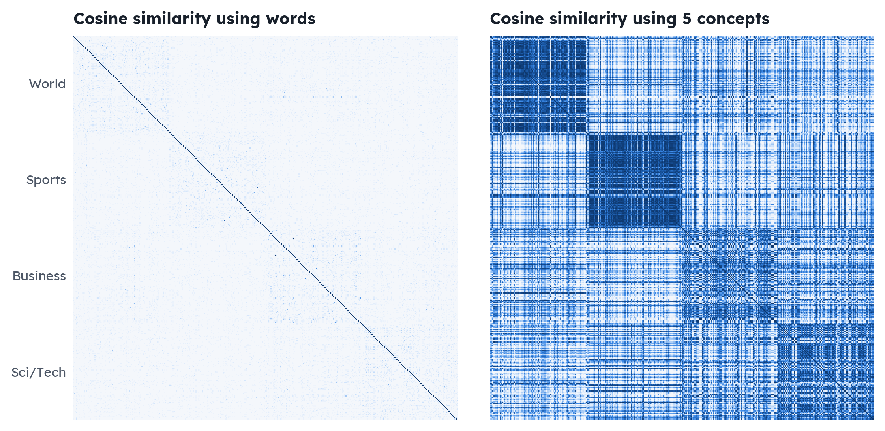

# Clustering ideas, not words

**Latent Semantic Analysis (LSA) with the singular value decomposition.**
Mathematical Foundations of Data Science: mini-project.

Turn a collection of documents into a term–document matrix, factorise it with the SVD, keep the strongest *k* concepts, and use that low-rank space to cluster documents by topic and to search by meaning. The project comes with an interactive learning app that walks through every step live, a rebuilt slide deck, and tests that check the linear algebra.



## Results

400 real news articles (AG News, 100 each from World, Sports, Business, Sci/Tech), k-means with 4 clusters, mean of 10 runs:

| Representation | Dimensions | ARI vs. true sections | NMI |
| :-- | --: | --: | --: |
| Raw TF-IDF | 1,404 | 0.07 ± 0.02 | 0.12 |
| **LSA concept space, k = 5** | **5** | **0.54 ± 0.00** | **0.50** |

The same algorithm agrees with the real topics about **8× better** after the SVD, even though k = 5 keeps only **4.9%** of the matrix's energy.

Other checks the code reproduces:

- **Eckart–Young:** measured ‖A − A₅‖_F = 19.5045, theory √(σ₆² + … + σ₄₀₀²) = 19.5045.
- **Synonymy (Deerwester et al., 1990):** "human" and "user" never share a title, yet their correlation goes from −0.38 in A to +0.94 at rank 2, exactly as published.
- **Search:** for the query *computer virus*, 9 of the top 10 LSA results share no word with the query.

All numbers are in [`results/metrics.json`](results/metrics.json) and regenerate with one command.



## Quick start

```bash
pip install -r requirements.txt

streamlit run app.py          # the interactive learning app
python main.py report         # print the analysis, write results/metrics.json
python main.py figures        # + regenerate every figure in figures/
python main.py deck           # + rebuild presentation/MFDS_LSA_Presentation.pptx
python -m pytest -q           # 30 checks of the maths
```

On Windows you can double-click `launch_app.bat` (it runs `py -m streamlit run app.py`). Everything runs offline: the data and fonts are in the repository.

## The learning app

Seven short chapters, one per step of the pipeline. Every chart recomputes when you change the documents, the weighting or k in the sidebar.

| Chapter | What you see and do |
| :-- | :-- |
| The big idea | Two articles with no words in common: cosine 0.00 in word space, 0.98 in concept space. The SVD drawn to scale. |
| 1. Word counts | Pick any document and see which words are kept, and its bag of words. |
| 2. The matrix A | The term–document matrix, a TF-IDF entry worked out by hand, and why raw cosine similarity fails. |
| 3. SVD | Every property of A = UΣVᵀ checked numerically; rebuild A one rank-1 layer at a time. |
| 4. Choosing k | Singular values, energy, the Eckart–Young theorem verified live, and clustering quality for every k. |
| 5. Reading concepts | The words at each end of a concept, a word map, and synonymy before and after compression. |
| 6. Clustering | k-means in raw vs. concept space, the two similarity matrices, confusion matrices, cluster keywords. |
| 7. Search | Fold a query into concept space; results that share no word with the query are highlighted. |
| Try your own documents | Paste text, one document per line (optionally `topic | text`), and run every chapter on it. |
| Formula sheet and viva questions | All formulas in one place and 15 likely viva questions with answers. |

Each chapter ends with a *Check yourself* question.

## How it works

| Step | Maths | Code |
| :-- | :-- | :-- |
| 1. Weight words | `A_ij = w_ij / ‖w_·j‖`, `w_ij = (1 + ln c_ij)(ln((1+n)/(1+df_i)) + 1)` | `lsa_lab/text.py` |
| 2. Factorise | `A = U Σ Vᵀ`, `AᵀA vᵢ = σᵢ² vᵢ` | `lsa_lab/model.py` |
| 3. Truncate | `A_k = U_k Σ_k V_kᵀ`, error `√(Σ_{i>k} σᵢ²)` | `LSA.reconstruct`, `LSA.eckart_young` |
| 4. Coordinates | documents `U_kᵀ aⱼ = Σ_k vⱼ`, words `Σ_k uᵢ` | `LSA.doc_coords`, `LSA.term_coords` |
| 5. Cluster | k-means on unit-length vectors (cosine geometry) | `lsa_lab/clustering.py` |
| 6. Search | `q̂ = Σ_k⁻¹ U_kᵀ q`, score `cos(U_kᵀq, U_kᵀaⱼ)` | `LSA.fold_in`, `Experiment.search` |

The TF-IDF weighting is written out by hand so every number can be traced to a formula; a test checks it equals scikit-learn's `TfidfVectorizer(sublinear_tf=True)`. Singular vectors are only defined up to sign, so the code fixes the sign (largest word weight positive) to make results reproducible.

## Data

| Collection | Matrix A | Why it is here |
| :-- | --: | :-- |
| Classic: 9 paper titles | 12 × 9 | The worked example from Deerwester et al. (1990), small enough to read every number. |
| Science: 24 blurbs | 285 × 24 | The first version of this project. Documents share almost no words, so its spectrum is flat. |
| News: 400 articles | 1,404 × 400 | Real text from the AG News test split, the main benchmark. |

See [`data/README.md`](data/README.md) for sources and how the news sample was made.

## Project structure

```
app.py                  Streamlit entry point (navigation + experiment setup in the sidebar)
app_pages/              one file per chapter, plus shared.py (state, caching, components, chart style)
lsa_lab/                the analysis package, one module per pipeline step
  corpora.py            the three collections and custom text
  text.py               documents -> term-document matrix (counts or TF-IDF)
  model.py              SVD, truncation, Eckart-Young, concepts, folding-in, similarities
  clustering.py         k-means raw vs. concept space, multi-seed scores, k sweep, confusion
  pipeline.py           corpus -> matrix -> SVD in one object, search, showcase pair
  report.py             runs everything and writes results/metrics.json
  figures.py            static figures for the deck and this README
  deck.py               builds the PowerPoint from the results
  style.py              shared colours: U teal, Σ ochre, V violet, colour-blind-safe topic colours
main.py                 command line: report | figures | deck | app
data/                   news_400.csv, science_24.json (+ sources)
figures/                generated figures and app screenshots
presentation/           the generated slide deck (with speaker notes)
results/metrics.json    every number used in the deck and README
tests/test_lsa.py       30 checks of the maths
docs/project_brief.jpg  the original project idea
static/fonts/           Lexend and Literata, served locally so the app works offline
```

## What changed from the first version

- **Data.** The 24 one-sentence documents barely share vocabulary, so the singular values were nearly flat (1.22, 1.17, 1.15, …) and 4 concepts kept only 22% of the energy. The project now adds the classic 1990 example and 400 real news articles, and keeps the original set to show why shared vocabulary matters.
- **Fair comparisons.** Silhouette scores computed in a 285-dimensional and a 4-dimensional space are not comparable, so they are no longer used to claim an improvement. Clustering is scored with ARI and NMI against the true labels, averaged over 10 seeds.
- **Folding-in.** The slides said `q Σ⁻¹ U` but the code compared `Uᵀq` with documents. Both are now stated and implemented consistently, and a test checks that folding in a document returns its own coordinates.
- **Topics.** Topic labels on the old heatmap were hard-coded. Concepts are now read from both ends (positive and negative words) with a fixed sign convention.
- **Structure.** One package, one entry point, cross-platform commands, tests, and a deck generated from the same results.

## References

- Deerwester, Dumais, Furnas, Landauer and Harshman (1990). Indexing by Latent Semantic Analysis. *Journal of the American Society for Information Science* 41(6), 391–407.
- Landauer, Foltz and Laham (1998). An Introduction to Latent Semantic Analysis. *Discourse Processes* 25, 259–284.
- Eckart and Young (1936). The approximation of one matrix by another of lower rank. *Psychometrika* 1, 211–218.
- Zhang, Zhao and LeCun (2015). Character-level Convolutional Networks for Text Classification. *NeurIPS* (AG News dataset).
